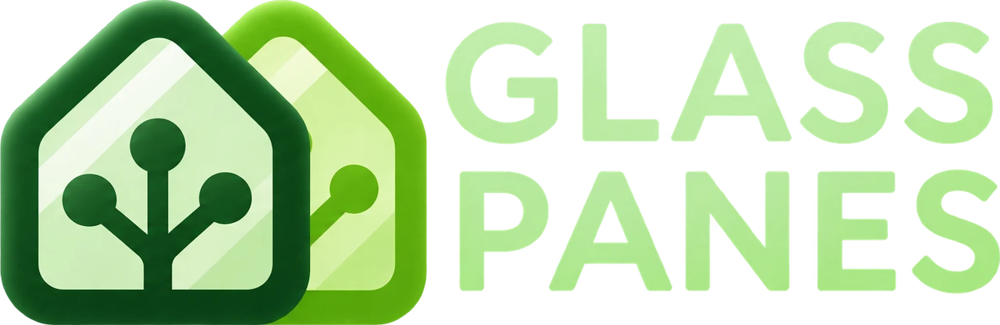
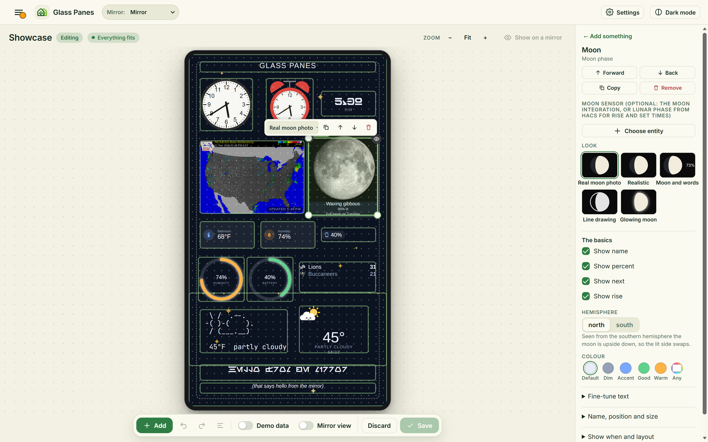
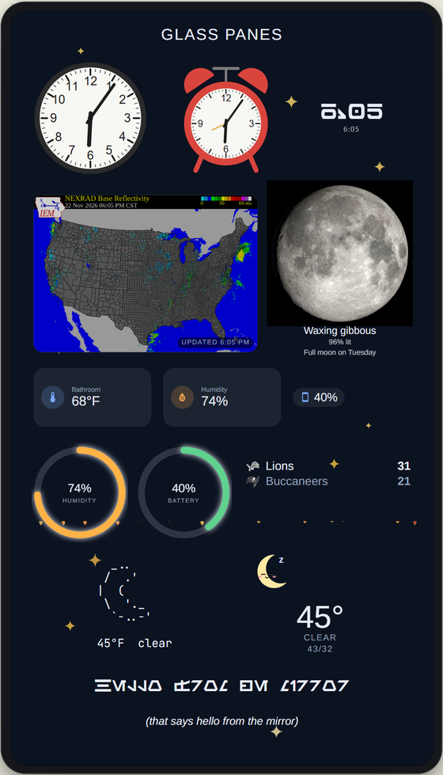
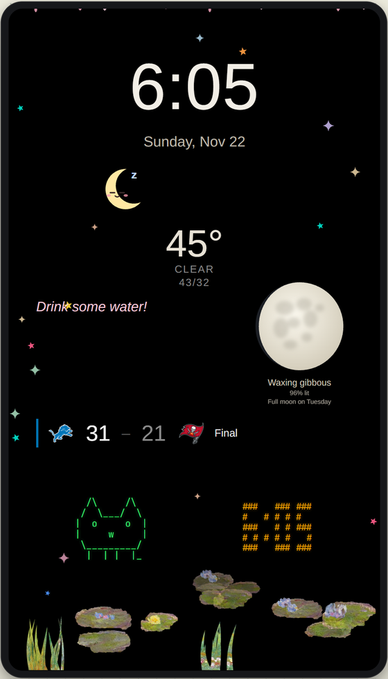
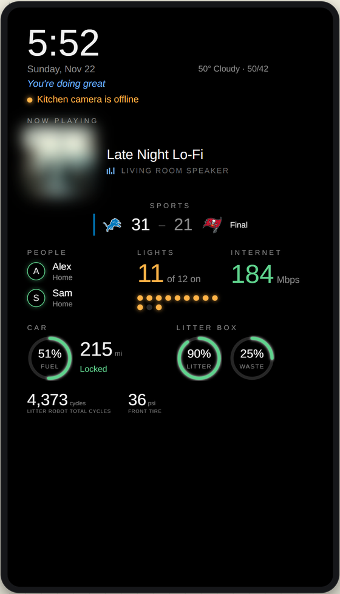
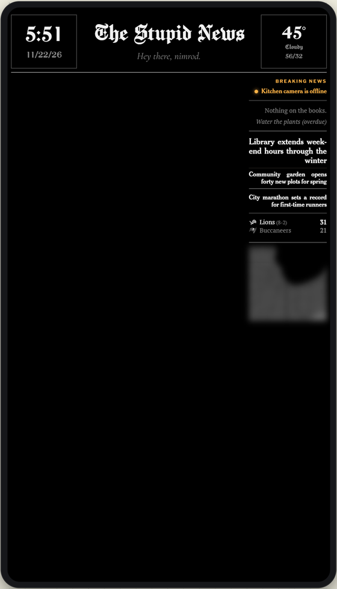
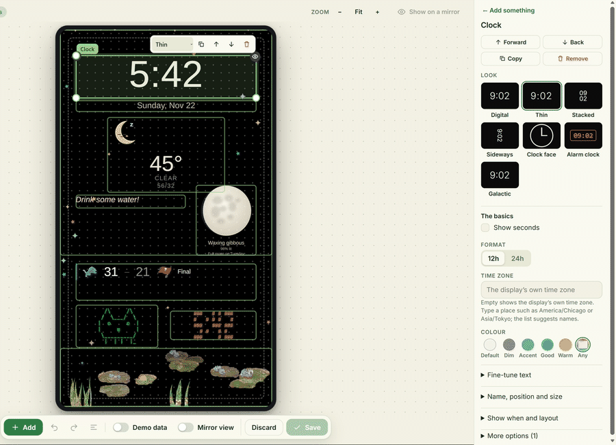
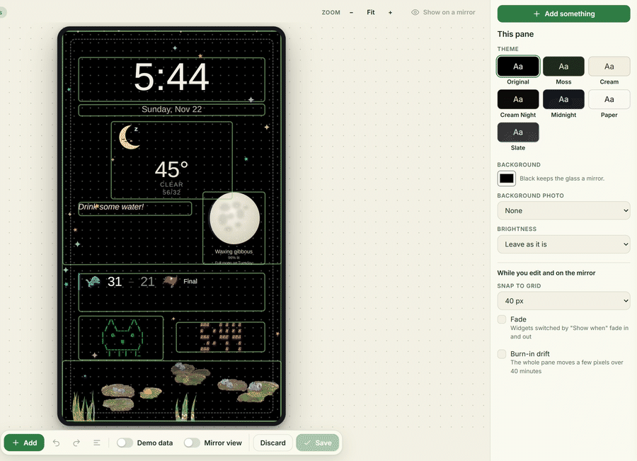

  

# Glass Panes

Design screens for your **Lululemon Studio smart mirror** inside Home Assistant, then switch between them with your own automations. Each screen is a **pane**.

> **Public beta (v0.13.x).** It works and it runs daily on a real mirror, but there are rough edges. If you hit one, please tell us on [Discord](https://discord.gg/ueUDvpYGU) or GitHub (see [Beta testing](#beta-testing)).

> **What's next:** more custom widgets, a shared inventory of widgets people make, and support for the newer (VPY / NXP) mirror. See the [roadmap](docs/roadmap.md).

> **Built for the Lululemon Studio mirror.** It was developed on one unit (board `MIR63A0-00-P1`, revision RevP21), and other owners have since reported RevP18, RevP19, RevP20 and RevP21 units working. The list is in [Which mirrors work](docs/compatibility.md#which-mirrors-work).
>
> **Check before you buy or flash:** the sticker near the power input has an FCC ID. `2AOSD-RLSYM1R0` is the board these images are made for. `VPYLBEE5HY1MW` is a newer, NXP-based board that these images **don't** support yet; there's a community Linux port for it ([lemonademirror](https://github.com/ikiiftekhar2/lemonademirror)), and we're looking for volunteers to try a kiosk browser on top of it. See [Which board do I have?](docs/mirror-app/hardware.md#which-board-do-i-have), and please [tell us how yours goes](https://github.com/git-nimrod/glass-panes/issues/new/choose).

  

The builder, editing a pane on a real Home Assistant.

<table>
  <tr>
    <td align="center"> A bit of everything</td>
    <td align="center"> Just for fun</td>
    <td align="center"> The whole house</td>
    <td align="center"> A morning paper</td>
  </tr>
</table>

Real panes on a real house. Names, headlines and a few other personal bits were changed or blurred for these pictures.

  
  

One click changes a widget's look, and everything drags and snaps to a grid.

## What you get

- **A drag-and-drop builder** in your Home Assistant sidebar (admins only). Pick your own entities, drop them on a 1080 x 1920 portrait canvas, resize, align, undo, save.
- **Pictures and looping videos** you upload from your computer or phone.
- **Looks you can change in a click:** named looks for each widget, colour themes (including one made for two-way mirror glass), lots of bundled fonts, a vinyl or CD look for Now playing, and clocks with their own time zone. Text can be edited right on the canvas.
- **Fun widgets:** Monet's water lilies, falling petals, sparkles, ASCII art, the moon, planes overhead, live radar and sports scorebugs. The full list is in [What's built in](#whats-built-in).
- **Photos and music:** a slideshow from a Home Assistant media folder, pictures from image and camera entities, and the mirror's own speaker as a media player that Music Assistant can play to.
- **Icons, tiles, chips and tables:** 7,400+ Material Design Icons, entity values drawn as tiles or chips, and a Table widget that formats times, durations and numbers for you.
- **Colours that follow your data.** Change a widget's colour, size or icon when a value goes above, below or between numbers, and edit the warnings a Status summary shows.
- **Widgets that switch on and off.** Show a photo when no team plays today, a warning only when a door is open, a different layout at night.
- **Reusable groups:** save a set of widgets with their look and entities, and drop it into any pane with one click.
- **One `select` entity per display** (plus a button per pane), so normal Home Assistant automations decide what each screen shows. A mirror also gets a **Brightness** number, a **Presence detection** switch, a **Screen** switch with quiet hours (the panel goes fully dark), and blueprints that brighten it when someone walks up or follow a light sensor.
- **Voice and Bluetooth on the mirror** (all off until you switch them on): a Home Assistant voice assistant with its own wake word ("Okay Nabu", "Hey Jarvis" or "Hey Mycroft") running on the mirror, and a Bluetooth proxy for nearby sensors and trackers.
- **App updates from Home Assistant.** On the `mirror-android-3` image the mirror app is built in, and its update entity installs new versions with no cable.
- **Pair a mirror with a six-digit code** shown on its screen. Home Assistant sets it up, with no token to copy.
- **A player page** that draws a pane full screen. The Mirror Kiosk app runs it on your mirror, and any browser can open it too.
- **A limited login per display**, made with one button, so you never paste a token into a device by hand.
- **Shareable panes.** Export a pane as a file and send it to a friend. Only the layout travels, never your entities or uploads.
- **AI agents can build panes for you.** Connect Home Assistant's MCP Server and an agent designs a whole pane in a private draft, widget by widget, with the same safety checks as the builder. When it's done, the pane is waiting for you to edit by hand ([docs/agents.md](docs/agents.md)). The same steps are available as services for automations.

## What's built in

Every widget needs no setup to drop in. The ones that show your data start empty until you pick an entity, and nothing from anyone's house is built in.

**Just for fun**

| Widget | Looks |
|---|---|
| **Lily pond** | Pieces cut from Claude Monet's *Water Lilies* (public domain), arranged into a new pond every day. Monet lilies, Monet flat, or your own cut-outs |
| **Falling petals** | Sakura, white blossom, autumn leaves, still petals |
| **Sparkles** | Pastel twinkles, starry, gold, frost, kira glints, or across the whole screen. A new scatter every day |
| **ASCII art** | Text art from a small built-in library, your own, or an ASCII clock. Green terminal, amber terminal, plain |
| **Moon phase** | Tonight's moon with its real shadow and the next full moon. Real moon photo, realistic, moon and words, line drawing, glowing moon |
| **Planes overhead** | The nearest plane, a radar, or an airport departures board (needs FlightRadar24 or a flights integration) |
| **Weather radar** | A live radar map. Rounded, round window, edge to edge |
| **Sports** | Today's games for your teams, with **19 scorebug styles** from broadcast-style boxes to smoked glass. Scorebug, big score, compact, one line |

**Everyday**

| Widget | What it shows |
|---|---|
| **Clock** | Digital, thin, stacked, sideways, a clock face, an alarm clock, or Galactic (our own sci-fi alphabet) |
| **Date** | Today, or another day, in the format you choose |
| **Weather** | Now and the forecast. One line, stacked, chibi, chibi line |
| **Calendar agenda** | Your next events from one or more calendars |
| **To-do list** | The open items of a list |
| **Now playing** | Cover, title and artist as a card, a vinyl record or a CD |
| **People** | Who's home, with their pictures |
| **Lights summary** | How many lights are on |
| **Status summary** | A warning line when something needs attention, like an open door |
| **Progress ring** | A number as a ring, like a battery or humidity |
| **Entity value** | Any entity as text, a tile or a chip, with colours that follow the value |
| **Table** | Rows of entities with their states and attributes, nicely formatted |
| **Message** | A rotating friendly line. Plain, speech bubble, thought bubble, Galactic bubble |
| **News** and **web feeds** | Headlines from your news feeds or any RSS / Atom address |

**Pictures and layout:** image (uploads or a camera), photo slideshow, looping video, icon (7,400+ Material Design Icons), text and divider lines.

**Looks for the whole pane:** 6 colour themes (moss, cream, cream night, midnight, paper, slate) and 57 fonts, all under open licences.

**On the mirror itself** (all off until you switch them on): a Home Assistant voice assistant with a wake word ("Okay Nabu", "Hey Jarvis" or "Hey Mycroft"), a Bluetooth proxy, camera presence (numbers only, never pictures), the speaker as a media player, and the screen fully off on a schedule.

## Two parts, installed separately

| Part | Where | What it is |
|---|---|---|
| **Home Assistant integration** (HACS) | [`custom_components/glass_panes/`](custom_components/glass_panes) | The builder, the player, pane storage and the entities. **Start here.** |
| **Mirror app** (Android kiosk) | [`mirror-app/`](mirror-app) | A small Android app that runs the player full screen on a Lululemon Studio mirror, with presence detection, voice and a Bluetooth proxy. It comes built into the ready-made `mirror-android-3` image. This is the main target. |

The integration also works on its own in any browser, which is handy for trying the builder before you touch your mirror. To put it on a mirror, follow [part 1 of the Lululemon Studio guide](docs/mirror-app/install-android-lululemon-studio.md): put the mirror in fastboot, run the installer, then pair it.

## Install it (HACS)

1. In HACS, open the three-dot menu (top right) and choose **Custom repositories**.
2. Paste `https://github.com/git-nimrod/glass-panes`, set the type to **Integration**, and click **Add**.
3. Find **Glass Panes** in HACS, click **Download**, then restart Home Assistant.
4. Go to **Settings > Devices & services > Add integration**, search for "Glass Panes", and click **Submit**.
5. Open **Glass Panes** in the sidebar. You need to be an administrator to see it.

Prefer to install by hand? Copy `custom_components/glass_panes/` into your `config/custom_components/` folder, restart, and do step 4.

## Set up your first mirror

1. Install the ready-made image with the installer ([part 1 of the mirror guide](docs/mirror-app/install-android-lululemon-studio.md)). When it's done, the mirror shows a six-digit code and its address.
2. In Home Assistant, open **Glass Panes > Mirrors > Add mirror**, type the code and the address, give it a name (like "Hall mirror"), and press **Add and pair**. Home Assistant sets up the mirror's login and sends it over by itself, so you never see a token.
3. Choose what it shows in the builder, or set the mirror's `select` entity from an automation.

Not a mirror? Any browser can be a display too: add one and use its sign-in link under **No code on the mirror?** The link is shown once.

Each mirror's login is its own ordinary Home Assistant user, just for that mirror. It is not an admin and it only works from your home network. Home Assistant can't limit a user to certain entities, so that login can read whatever any ordinary user can. You can delete it any time with **Revoke**.

The full walkthrough is in [Getting started](docs/getting-started.md).

## Beta testing

Thank you for trying this. It helps a lot when you:

- **Report bugs and ideas** on [GitHub Issues](https://github.com/git-nimrod/glass-panes/issues/new/choose). The form asks for the version numbers we need.
- **Keep secrets out of issues.** Never paste tokens, webhook addresses or anything private.
- **Come hang out on [Discord](https://discord.gg/ueUDvpYGU).** It's the quickest way to ask a question, share your panes or follow what's coming.

How releases work: the integration is tagged `v0.13.N` and called "public beta". The mirror app has its own releases (`app-v...`) because it changes much less often. Updating through HACS is safe: your panes, uploads and logins are kept. Which app version a feature needs: [docs/compatibility.md](docs/compatibility.md).

## Documentation

**Getting going**
- [Getting started](docs/getting-started.md)
- [Troubleshooting and FAQ](docs/troubleshooting.md)

**Putting it on a smart mirror**
- [Mirror hardware and what works](docs/mirror-app/hardware.md)
- [Part 1: install Android and the Glass Panes app on your Lululemon Studio mirror](docs/mirror-app/install-android-lululemon-studio.md)
- [Part 2: install the app by hand](docs/mirror-app/install-app-lululemon-studio.md) (only for mirrors still on images 1 or 2)
- [Which mirrors work](docs/compatibility.md#which-mirrors-work)
- [Update the mirror app](docs/mirror-app/update-app.md)
- [adb command glossary](docs/mirror-app/adb-commands.md)
- [Mirror app API and presence webhook](docs/mirror-app/api.md)

**Under the hood**
- [Player and sign-in](docs/player.md)
- [Pane format](docs/pane-schema.md)
- [Services, web and websocket API](docs/api.md)
- [Agents and automations](docs/agents.md)
- [How Glass Panes works](docs/how-it-works.md)
- [How Glass Panes is tested](docs/testing.md)

**Helping out:** [Contributing](.github/CONTRIBUTING.md). What is planned next is in the [roadmap](docs/roadmap.md).

## How it works and how it's checked

A short tour of the pieces is in [How Glass Panes works](docs/how-it-works.md), and what we check before every release is in [How Glass Panes is tested](docs/testing.md).

## License

[MIT](LICENSE).
