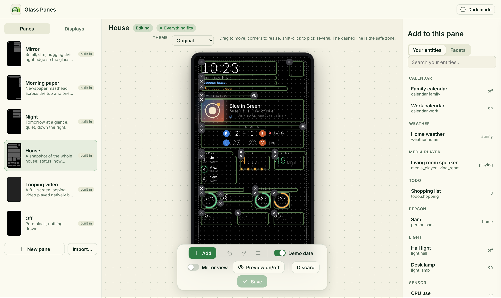

  

# Glass Panes

Design screens for your **Lululemon Studio smart mirror** inside Home Assistant, then switch between them with your own automations. Each screen is a **pane**.

> **Public beta (v0.11.x).** It works and it runs daily on a real mirror, but there are rough edges. If you hit one, please tell us (see [Beta testing](#beta-testing)).

> **What's next:** a Bluetooth proxy, a voice assistant, and support for the other FCC ID mirror are planned. See the [roadmap](docs/roadmap.md).

> **Built for the Lululemon Studio mirror.** It was developed and tested on one unit: board `MIR63A0-00-P1`, revision RevP21. We're building a list of which boards and firmware versions work, in [Which mirrors work](docs/compatibility.md#which-mirrors-work). **Check before you buy or flash:** there's a sticker near the power input with an FCC ID — `2AOSD-RLSYM1R0` matches the tested generation, while `VPYLBEE5HY1MW` is a different, newer generation (reportedly NXP-based) that these images do not support. See [Which board do I have?](docs/mirror-app/hardware.md#which-board-do-i-have). If you have a Studio mirror, please [tell us how yours goes](https://github.com/git-nimrod/glass-panes/issues/new/choose) — and if yours is the newer NXP-based generation, there's now a community Linux port ([lemonademirror](https://github.com/ikiiftekhar2/lemonademirror)) with display, audio, camera, WiFi and Bluetooth all working, and we're looking for volunteers to try a web kiosk browser on top of it for Glass Panes.

  

The builder, with made-up sample data.

## What you get

- **A drag-and-drop builder** in your Home Assistant sidebar (admins only). Pick your own entities, drop them on a 1080 x 1920 portrait canvas, resize, align, undo, save.
- **Pictures and looping videos** you upload from your computer or phone.
- **Looks you can change in a click:** six colour themes (including one made for two-way mirror glass), ten bundled fonts, a vinyl or CD look for Now playing, and a digital, traditional or alarm clock with its own time zone.
- **Photos and music:** a slideshow from a Home Assistant media folder, pictures from image and camera entities, and the mirror's own speaker as a media player that Music Assistant can play to.
- **Widgets that switch on and off.** Show a photo when no team plays today, a warning only when a door is open, a different layout at night.
- **One `select` entity per display** (plus a button per pane), so normal Home Assistant automations decide what each screen shows.
- **A player page** that draws a pane full screen. The Mirror Kiosk app runs it on your mirror, and any browser can open it too.
- **A limited login per display**, made with one button, so you never paste a token into a device by hand.
- **Shareable panes.** Export a pane as a file and send it to a friend. Only the layout travels, never your entities or uploads.
- **AI agents can build panes for you.** Connect Home Assistant's MCP Server and an agent designs a whole pane in a private draft, widget by widget, with the same safety checks as the builder. When it's done, the pane is waiting for you to edit by hand ([docs/agents.md](docs/agents.md)). The same steps are available as services for automations.

## Two parts, installed separately

| Part | Where | What it is |
|---|---|---|
| **Home Assistant integration** (HACS) | [`custom_components/glass_panes/`](custom_components/glass_panes) | The builder, the player, pane storage and the entities. **Start here.** |
| **Mirror app** (Android kiosk) | [`mirror-app/`](mirror-app) | A small Android app that runs the player full screen on a Lululemon Studio mirror, with presence detection. This is the main target. |

The integration also works on its own in any browser, which is handy for trying the builder before you touch your mirror. To put it on a mirror, follow the two Lululemon Studio guides listed under [Documentation](#documentation).

## Install it (HACS)

1. In HACS, open the three-dot menu (top right) and choose **Custom repositories**.
2. Paste `https://github.com/git-nimrod/glass-panes`, set the type to **Integration**, and click **Add**.
3. Find **Glass Panes** in HACS, click **Download**, then restart Home Assistant.
4. Go to **Settings > Devices & services > Add integration**, search for "Glass Panes", and click **Submit**.
5. Open **Glass Panes** in the sidebar. You need to be an administrator to see it.

Prefer to install by hand? Copy `custom_components/glass_panes/` into your `config/custom_components/` folder, restart, and do step 4.

## Set up your first display

1. In **Glass Panes > Displays**, add a display, like "Hall mirror".
2. Press **Set up login**. You get a link and a token. They are shown once.
3. Open that link in the display's browser. It signs itself in and shows a pane. (On a Lululemon Studio mirror, the Mirror Kiosk app does this for you. Part 2 of the mirror guide shows how.)
4. Choose what it shows in the builder, or set the display's `select` entity from an automation.

The login is its own ordinary Home Assistant user, just for that display. It is not an admin and it only works from your home network. Home Assistant can't limit a user to certain entities, so that login can read whatever any ordinary user can. You can delete it any time with **Revoke**.

The full walkthrough is in [Getting started](docs/getting-started.md).

## Beta testing

Thank you for trying this. It helps a lot when you:

- **Report bugs and ideas** on [GitHub Issues](https://github.com/git-nimrod/glass-panes/issues/new/choose). The form asks for the version numbers we need.
- **Keep secrets out of issues.** Never paste tokens, webhook addresses or anything private.
- **Watch for a Discord server** for beta testers. It's being set up, and the invite link will go here.

How releases work: the integration is tagged `v0.11.N` and called "public beta". The mirror app has its own releases (`app-v...`) because it changes much less often. Updating through HACS is safe: your panes, uploads and logins are kept. Which app version a feature needs: [docs/compatibility.md](docs/compatibility.md).

## Documentation

**Getting going**
- [Getting started](docs/getting-started.md)
- [Troubleshooting and FAQ](docs/troubleshooting.md)

**Putting it on a smart mirror**
- [Mirror hardware and what works](docs/mirror-app/hardware.md)
- [Part 1: install Android on your Lululemon Studio mirror](docs/mirror-app/install-android-lululemon-studio.md)
- [Part 2: install the Glass Panes app on your Lululemon Studio mirror](docs/mirror-app/install-app-lululemon-studio.md)
- [Update the mirror app](docs/mirror-app/update-app.md)
- [adb command glossary](docs/mirror-app/adb-commands.md)
- [Mirror app API and presence webhook](docs/mirror-app/api.md)

**Under the hood**
- [Player and sign-in](docs/player.md)
- [Pane format](docs/pane-schema.md)
- [Services, web and websocket API](docs/api.md)
- [Agents and automations](docs/agents.md)
- [How Glass Panes works](docs/how-it-works.md)
- [How Glass Panes is tested](docs/testing.md)

**Helping out:** [Contributing](.github/CONTRIBUTING.md). What is planned next is in the [roadmap](docs/roadmap.md).

## How it works and how it's checked

A short tour of the pieces is in [How Glass Panes works](docs/how-it-works.md), and what we check before every release is in [How Glass Panes is tested](docs/testing.md).

## License

[MIT](LICENSE).
