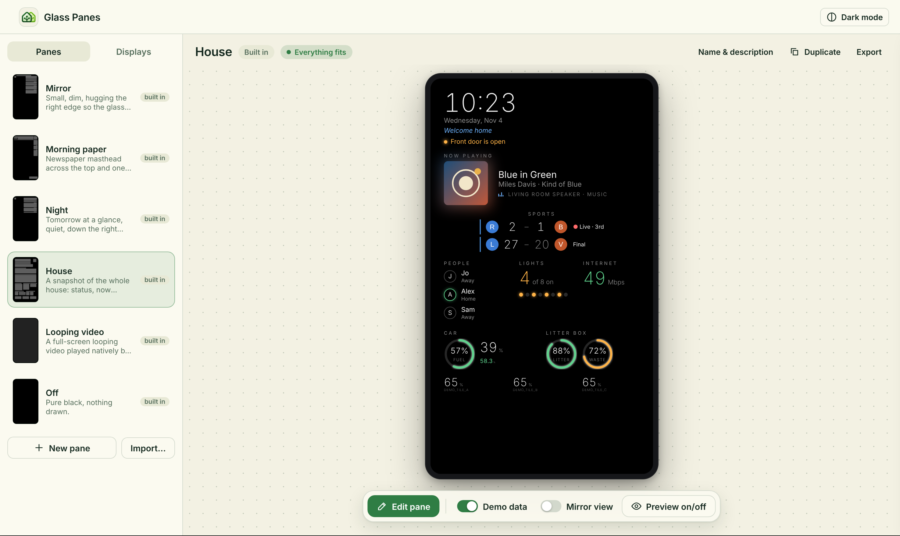
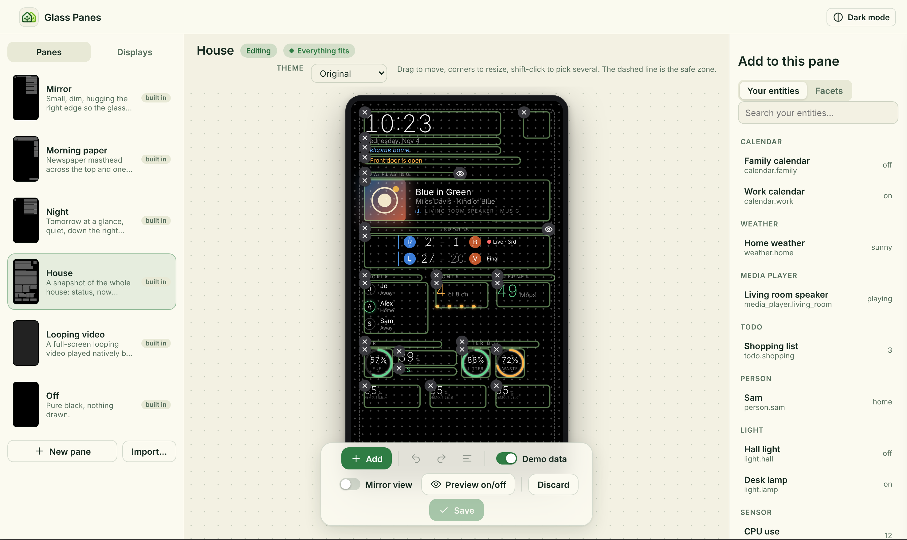
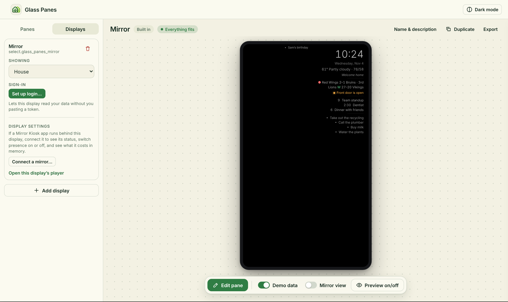

# Getting started

This takes about ten minutes and ends with a pane on a screen. Glass Panes is built for the Lululemon Studio mirror, but you can try everything in an ordinary browser first, and that is the quickest way to start. You need Home Assistant (a recent release; the project is tested on 2026.10) and HACS.

## 1. Install

1. In HACS, open the three-dot menu (top right) and choose **Custom repositories**.
2. Paste `https://github.com/git-nimrod/glass-panes`, set the type to **Integration**, and click **Add**.
3. Find **Glass Panes** in HACS and click **Download**. Then restart Home Assistant (**Settings > System > Restart**).
4. Go to **Settings > Devices & services > Add integration**, search for "Glass Panes", and click **Submit**. Only one copy can be added.
5. A **Glass Panes** item shows up in the sidebar. Only administrators see it. If it's missing, reload the browser page, then check you're signed in as an admin.

## 2. Look around the builder

- **Panes** is the list of screens. A few example panes come built in. They have nothing bound, so they show empty states until you pick your own entities.
- **Displays** is where you list the screens you own, such as your mirror. Each display shows one pane at a time.
- The **light / dark look** (top bar) is just for the builder itself. **Mirror view** draws your pane behind glass, marks the edges of the real screen, and warns you when something sits outside the safe zone.



## 3. Make your first pane

1. Go to **Panes > +** and give it a name. The id is made from the name and never changes, so you can rename the pane later without breaking anything.
2. Press **Edit**. The editor opens next to the canvas.
3. **Start with an entity.** Search for one of your own (a weather entity, a calendar, a sensor). Glass Panes suggests the right widget for it. Click to drop it on the canvas.
4. **Facets** is the drawer for things that need no entity: clock, date, text, picture, video, divider and message.

   
5. Drag to move, pull a corner to resize. Everything snaps to a 40 px grid. The align and distribute buttons tidy up a selection, and undo and redo are in the top bar.
6. Press **Save**. If a widget is hard to read (low contrast, or too small to read across a room), it gets a warning. Warnings never stop you from saving.

**Pictures and videos:** select a picture or video widget and choose **Upload** in the panel on the right. You can pick a file from your computer, or a photo or file from your phone. Files go to protected storage, never a public folder. Pictures can be up to 25 MB, videos up to 100 MB, and SVG isn't allowed.

### Colours, fonts and Now playing looks

- **Theme** (the menu above the preview while you edit) restyles the whole pane at once. The choices are `moss`, `cream`, `creamnight`, `midnight`, `paper` and `slate`, and **Original** removes the theme. A two-way mirror only shows dark colours, so **Cream Night** (cream text on a very dark warm background) is the cream look made for glass. The bright **Cream** and **Paper** themes suit a tablet or wall panel better.
- **Fonts** live in the Text section of a widget. Ten are bundled, and a font only downloads when a pane uses it.
- **Now playing** has a **Look**: the default card, a spinning **vinyl** record with a tonearm, or a **CD**. They only move while a song is playing. The **Burn-in saver** switch drifts the block a few pixels over 40 minutes, so a screen left on for hours never holds the same pixels. It's off by default and works with every look.

## 4. Make a display and sign it in



1. Go to **Displays > Add display** and name it (for example "Hall mirror").
2. Press **Set up login**. You get a link and a token. **They are shown once**, and Glass Panes keeps the token nowhere.
3. Open that link in the screen's browser. It signs itself in and shows the display's pane.
4. Choose what it shows in the builder, or use an automation (next step).

The login is a separate, ordinary Home Assistant user for that one display. It is not an admin, and it only works from your home network. Home Assistant can't limit a user to certain entities, so it can read whatever any ordinary user can. **Revoke** deletes the user. **Replace** makes a new login and stops the old one working.

## 5. Switch panes automatically

Each display gets a `select` entity (for example `select.glass_panes_hall_mirror`) whose options are your panes, plus a button for each pane. Use them like any other entity:

```yaml
# Switch to your own "Night" pane after 22:00
automation:
  - alias: Mirror night pane
    trigger:
      - platform: time
        at: "22:00:00"
    action:
      - action: select.select_option
        target:
          entity_id: select.glass_panes_hall_mirror   # use your display's entity
        data:
          option: night                                   # the id of a pane you made, here one named "Night"
```

You can also call the service `glass_panes.show_pane`. Any normal trigger works: presence, a door, a media player starting, a scene.

### Widgets that switch on and off

Click a widget in edit mode and look for **Show when** in the panel on the right. Leave it on **Always**, or choose **Conditions** and **+ Add a condition**. A condition can be:

- another widget has something to show (or nothing),
- an entity is in a state (for example a door sensor is `on`),
- a time of day, or
- certain days of the week.

**Example:** put a photo on top of your sports widget and give the photo the condition "Sports has nothing to show". On days without a game, the photo fills the spot.

With no rule at all, the default is simpler. A sports widget with nothing to show takes no space, so whatever sits below it slides up into its place.

A few more controls:

- **Close the gap / Keep the space** (just below the rule) decides what the widgets underneath do when this one is off or empty. They either move up, or stay put.
- **Place below** makes a widget follow another one down the screen, so a shorter or missing widget above never leaves a hole.
- The **eye** on a widget's box, **Preview on/off** in the toolbar, and the **Preview** row in the panel force a widget on or off so you can see both layouts. They only change what you see. Nothing is saved.
- An entity condition needs an entity chosen (**Choose entity...**). Until you pick one, the widget stays off.
- **Fade** (in the toolbar while editing) makes widgets fade in and out over half a second when their rule switches them, instead of popping. New panes start with it on.

### Recipe: a mirror that wakes up when you walk up

The mirror stays plain glass until someone stands in front of it, then the clock and your day fade in. It needs the Mirror Kiosk app with presence on, and a toggle in Home Assistant that follows it:

1. **Make the toggle.** Settings > Devices & services > **Helpers** > **+ Create helper** > **Toggle**. Call it "Someone at the mirror".
2. **Let the mirror switch it.** Set up the webhook automation in [the mirror app's control API](mirror-app/api.md#the-home-assistant-side), pointing it at that toggle.
3. **Make the widgets wait for it.** Open your pane, click **Edit pane**, tick **Fade** in the toolbar. Then click each widget that should wake up, one at a time: **Show when** > **Conditions** > **+ Add a condition** > an entity is in a state > **Choose entity...** > "Someone at the mirror", state `on`.
4. **Leave something calm on.** A widget with no rule stays on all the time, so a small clock or nothing at all can stay while the rest wakes up. Pure black is see-through on the mirror, so with everything off it is just a mirror.
5. **Tune how long it stays awake.** The mirror counts you as "there" for 30 seconds after the last movement. Change it with the `glass_panes.tune_mirror_presence` action and its `hold` field (seconds), for example from Developer tools > Actions.

Want the backlight lower when nobody's there too? Add an automation on the same toggle that calls `glass_panes.set_mirror_brightness`.

## 6. Share a pane

**Export** on a pane downloads a file with the layout only. **Import** loads one. Entities and uploaded files never travel, so the person importing binds their own.

## 7. Put it on your Lululemon Studio mirror

This is what Glass Panes is for. There are two guides, to do in order:

1. [Part 1: install Android on the mirror](mirror-app/install-android-lululemon-studio.md). Check [which boards work](compatibility.md#which-mirrors-work) first. This permanently replaces the mirror's own software.
2. [Part 2: install the Glass Panes app](mirror-app/install-app-lululemon-studio.md).

Any other screen with a browser (a tablet, a wall panel) can open the display's login link instead. That path works, but it gets much less testing.

### Display settings (if the mirror runs the Mirror Kiosk app)

1. Open **Glass Panes** in the sidebar, then the **Displays** tab.
2. On the display's card, under **Display settings**, press **Connect a mirror...**. Type the mirror's address: the host, plus the port if it isn't 8099, for example `mirror.local:8099`. Add its key only if you set one on the mirror. Press **Save**. Nothing else is accepted (no `user:password@`, no path).
3. The card now shows whether the page is loaded and what presence is doing. You also get a **Presence detection** switch, the presence settings in plain words with their allowed ranges (press **Apply settings** to save changes), brightness, and the memory the mirror reports.
4. **Measure what presence costs...** asks you first, then turns presence off for about 20 seconds, compares the mirror's memory before and after, and turns presence back on. The numbers are what the mirror reported, with the time they were read.

Home Assistant talks to the mirror, not your browser, so the mirror has to be reachable from Home Assistant. The key is saved but never shown again. To change it, press **Change connection...** and type a new one.

## 8. Agents and automations

Everything the builder does can also be done with services, with the same safety checks. An AI agent can even design a whole pane for you through Home Assistant's MCP Server, working in a private draft and saving it when it's done, so you can open it in the builder and edit it by hand. See [agents.md](agents.md).

## Updating, backups and removing

- **Update:** when HACS shows a new release, click **Download**. Restart Home Assistant if the release notes say Python changed. Your panes, uploads and logins are kept. If the builder looks old after an update, reload the page once.
- **Backups:** your data lives in Home Assistant's own storage, in `config/.storage/` files named `glass_panes.*`, plus the uploaded files in Glass Panes' media storage. A normal Home Assistant backup includes both. It's also worth exporting your favourite panes as files.
- **Removing:** go to **Settings > Devices & services > Glass Panes**, open the three dots, and choose **Delete**. Afterwards you can delete it in HACS too.
  - Deleting the integration **revokes every display login**. The "Glass Panes: ..." users are deleted and their tokens stop working, so any display that was signed in goes dark.
  - Home Assistant removes the pane `select` and button entities by itself.
  - Your **panes, display list, bindings and uploaded pictures and videos are kept** (in `config/.storage/` and Glass Panes' media storage). If you add the integration again, your work comes back. You only need to press **Set up login** again on each display.
  - To wipe everything for good, delete the `glass_panes.*` files and the uploaded media yourself while Home Assistant is stopped.

Having trouble? See [troubleshooting.md](troubleshooting.md).
