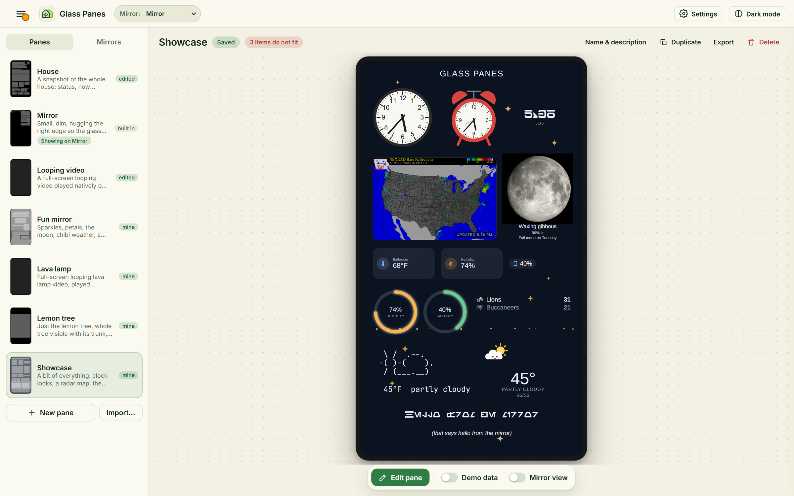
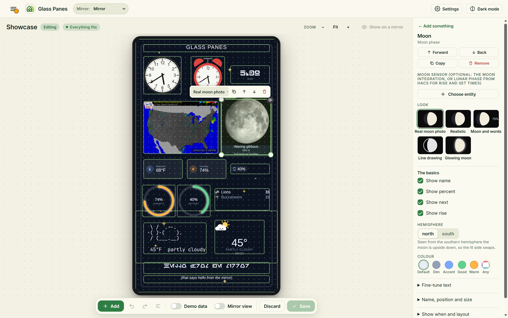
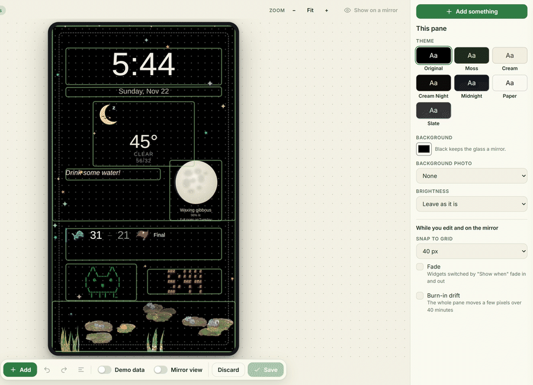
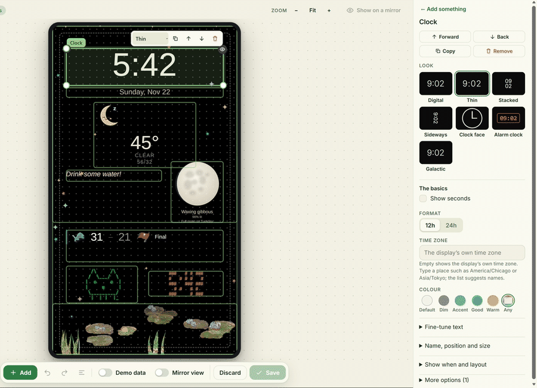
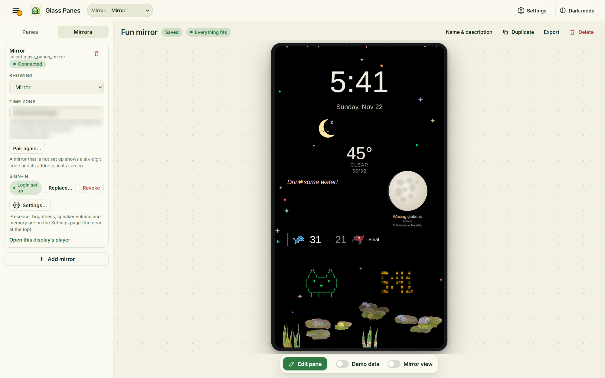

# Getting started

This takes about ten minutes and ends with a pane on a screen. Glass Panes is built for the Lululemon Studio mirror, but you can try everything in an ordinary browser first, and that is the quickest way to start. You need Home Assistant (a recent release; the project is tested on 2026.10) and HACS.

## 1. Install

1. In HACS, open the three-dot menu (top right) and choose **Custom repositories**.
2. Paste `https://github.com/git-nimrod/glass-panes`, set the type to **Integration**, and click **Add**.
3. Find **Glass Panes** in HACS and click **Download**. Then restart Home Assistant (**Settings > System > Restart**).
4. Go to **Settings > Devices & services > Add integration**, search for "Glass Panes", and click **Submit**. Only one copy can be added.
5. A **Glass Panes** item shows up in the sidebar. Only administrators see it. If it's missing, reload the browser page, then check you're signed in as an admin.

## 2. Look around the builder

- **Panes** is the list of screens. A few example panes come built in. They have nothing bound, so they show empty states until you pick your own entities.
- **Displays** is where you list the screens you own, such as your mirror. Each display shows one pane at a time.
- The **light / dark look** (top bar) is just for the builder itself. **Mirror view** draws your pane behind glass, marks the edges of the real screen, and warns you when something sits outside the safe zone.



## 3. Make your first pane

1. Go to **Panes > +** and give it a name. The id is made from the name and never changes, so you can rename the pane later without breaking anything.
2. Press **Edit**. The editor opens next to the canvas.
3. **Start with an entity.** Search for one of your own (a weather entity, a calendar, a sensor). Glass Panes suggests the right widget for it. Click to drop it on the canvas.
4. **Facets** is the drawer for things that need no entity: clock, date, text, picture, video, divider and message.

   
5. Drag to move, pull a corner to resize. Everything snaps to a 40 px grid.

   

   The align and distribute buttons tidy up a selection, and undo and redo are in the top bar.
6. Press **Save**. If a widget is hard to read (low contrast, or too small to read across a room), it gets a warning. Warnings never stop you from saving.

**Pictures and videos:** select a picture or video widget and choose **Upload** in the panel on the right. You can pick a file from your computer, or a photo or file from your phone. Files go to protected storage, never a public folder. Pictures can be up to 25 MB, videos up to 100 MB, and SVG isn't allowed.

### Colours, fonts and Now playing looks

- **Theme** (the menu above the preview while you edit) restyles the whole pane at once. The choices are `moss`, `cream`, `creamnight`, `midnight`, `paper` and `slate`, and **Original** removes the theme. A two-way mirror only shows dark colours, so **Cream Night** (cream text on a very dark warm background) is the cream look made for glass. The bright **Cream** and **Paper** themes suit a tablet or wall panel better.
- **Fonts** live in the Text section of a widget. Ten are bundled, and a font only downloads when a pane uses it.


- **Clock** has a **Look**: digital numbers, a traditional clock face, or an alarm clock (the two round looks also have a light or dark face and a red second hand with **Show seconds**). Its **Time zone** box shows another place's time, such as `America/Chicago`; the **Date** widget has one too.
- **Now playing** has a **Look**: the default card, a spinning **vinyl** record with a tonearm, or a **CD**. They only move while a song is playing. The **Burn-in saver** switch drifts the block a few pixels over 40 minutes, so a screen left on for hours never holds the same pixels. It's off by default and works with every look.

## 4. Add your mirror



A mirror running the Glass Panes app (0.12.0 or newer) shows a six-digit code and its address when it is new. Go to **Mirrors > Add mirror**, type the code and the address, give it a name (for example "Hall mirror"), and press **Add and pair**. Home Assistant makes the mirror's login and sends it to the mirror itself; you never see a token. The mirror's card then says when it has loaded its page. Details: [installing the app, step 7](mirror-app/install-app-lululemon-studio.md#7-start-the-app-and-point-it-at-your-display).

Each mirror's card starts with how it is connected: **Connected**, **Signed in with a link**, or **Not connected yet** (with **Pair with a code…** below it).

**Mirror app older than 0.12 (no code on its screen)?** Under the pairing form, press **No code on the mirror?**, name it, and press **Add and make the link**. You get a sign-in link and a token. **They are shown once**, and Glass Panes keeps the token nowhere; send it to the mirror with `adb` as in [installing the app, step 7a](mirror-app/install-app-lululemon-studio.md#7a-get-your-player-address-from-glass-panes).
   - The mirror's **id** is its name in lowercase with underscores: "Hall mirror" becomes `hall_mirror`. It is the small grey text under the name (`select.glass_panes_hall_mirror`), after `select.glass_panes_`. The easiest way to get it exactly right is the **Open this display's player** link on the card.

Then choose what it shows in the builder, or use an automation (next step).

The login is a separate, ordinary Home Assistant user for that one display. It is not an admin, and it only works from your home network. Home Assistant can't limit a user to certain entities, so it can read whatever any ordinary user can. **Revoke** deletes the user. **Replace** makes a new login and stops the old one working.

**Seeing what each screen shows.** You don't have to open the Displays tab to check. A strip at the top of the builder, on every tab, has one chip per display, like "Hall mirror: House". Open a chip to switch that display to another pane. On the Panes tab, a card for a pane that a display is showing carries a small "Showing on Hall mirror" tag. Click the tag to jump to that display. Both update by themselves when an automation switches a display, so there is nothing to reload.

## 5. Switch panes automatically

Each display gets a `select` entity (for example `select.glass_panes_hall_mirror`) whose options are your panes, plus a button for each pane. Use them like any other entity:

```yaml
# Switch to your own "Night" pane after 22:00
automation:
  - alias: Mirror night pane
    trigger:
      - platform: time
        at: "22:00:00"
    action:
      - action: select.select_option
        target:
          entity_id: select.glass_panes_hall_mirror   # use your display's entity
        data:
          option: night                                   # the id of a pane you made, here one named "Night"
```

You can also call the service `glass_panes.show_pane`. Any normal trigger works: presence, a door, a media player starting, a scene.

### Widgets that switch on and off

Click a widget in edit mode and look for **Show when** in the panel on the right. Leave it on **Always**, or choose **Conditions** and **+ Add a condition**. A condition can be:

- another widget has something to show (or nothing),
- an entity is in a state (for example a door sensor is `on`),
- a time of day, or
- certain days of the week.

**Example:** put a photo on top of your sports widget and give the photo the condition "Sports has nothing to show". On days without a game, the photo fills the spot.

With no rule at all, the default is simpler. A sports widget with nothing to show takes no space, so whatever sits below it slides up into its place.

A few more controls:

- **Close the gap / Keep the space** (just below the rule) decides what the widgets underneath do when this one is off or empty. They either move up, or stay put.
- **Place below** makes a widget follow another one down the screen, so a shorter or missing widget above never leaves a hole.
- The **eye** on a widget's box, **Preview on/off** in the toolbar, and the **Preview** row in the panel force a widget on or off so you can see both layouts. They only change what you see. Nothing is saved.
- An entity condition needs an entity chosen (**Choose entity...**). Until you pick one, the widget stays off.
- **Fade** (in the toolbar while editing) makes widgets fade in and out over half a second when their rule switches them, instead of popping. New panes start with it on.

### Recipe: a mirror that wakes up when you walk up

The mirror stays plain glass until someone stands in front of it, then the clock and your day fade in. It needs the Mirror Kiosk app with presence on, and a toggle in Home Assistant that follows it:

1. **Make the toggle.** Settings > Devices & services > **Helpers** > **+ Create helper** > **Toggle**. Call it "Someone at the mirror".
2. **Let the mirror switch it.** Set up the webhook automation in [the mirror app's control API](mirror-app/api.md#the-home-assistant-side), pointing it at that toggle.
3. **Make the widgets wait for it.** Open your pane, click **Edit pane**, tick **Fade** in the toolbar. Then click each widget that should wake up, one at a time: **Show when** > **Conditions** > **+ Add a condition** > an entity is in a state > **Choose entity...** > "Someone at the mirror", state `on`.
4. **Leave something calm on.** A widget with no rule stays on all the time, so a small clock or nothing at all can stay while the rest wakes up. Pure black is see-through on the mirror, so with everything off it is just a mirror.
5. **Tune how long it stays awake.** The mirror counts you as "there" for 30 seconds after the last movement. Change it with the `glass_panes.tune_mirror_presence` action and its `hold` field (seconds), for example from Developer tools > Actions.

Want the backlight lower when nobody's there too? Use the blueprint: in Home Assistant open **Settings > Automations & scenes > Blueprints > Import Blueprint** and paste `https://github.com/git-nimrod/glass-panes/blob/main/blueprints/automation/glass_panes/presence_brightness.yaml`. Create an automation from it, pick your toggle and your display's **Brightness** number (see "Controls Home Assistant gets for a mirror" below), and choose the two levels and how long to wait before dimming. A person walking back up cancels the wait.

Want the backlight to follow the room's light instead (dim at night, bright on a sunny afternoon)? Import `https://github.com/git-nimrod/glass-panes/blob/main/blueprints/automation/glass_panes/light_sensor_brightness.yaml` the same way. Pick any sensor that reports light in lux, your display's **Brightness** number, what counts as a dark and a bright room, and the lowest and highest brightness. It changes the brightness at most once per wait (30 seconds by default) and ignores small wobbles, so the mirror isn't asked over and over. Use one of the two blueprints per display, not both: they would fight over the same number.

### Controls Home Assistant gets for a mirror

Once a display has its mirror set up (the mirror address), Home Assistant gets these entities for it, on the display's device. Use them in dashboards, automations and scripts:

| Entity | What it is | Notes |
|---|---|---|
| `number.glass_panes_<display>_brightness` | The backlight, 0 to 100 % | Shows the mirror's real setting, read every 10 seconds. Unknown until something sets it (Android is in charge before that). 0 is as dark as the panel goes, not off. |
| `switch.glass_panes_<display>_presence_detection` | Camera presence on or off | Follows the mirror: it changes by itself if presence is switched in the Settings page. Numbers only, never pictures. |
| `switch.glass_panes_<display>_screen` | The screen on or off (mirror app 0.13.0 and later) | Off is fully black on mirror-android-2 and later; the mirror stays on the network, so switching it on works. On mirror-android-3 it works straight away; on older images, run `adb shell dpm set-active-admin com.nimrod.mirrorkiosk/.ScreenAdmin` once before the first "off". Unavailable with an older app. |
| `select.glass_panes_<display>_screen_mode` | How the screen is run: **Manual**, **Auto (quiet hours)**, **Always on**, **Always off** | Starts on Manual, which does nothing (the Screen switch is yours). See "Quiet hours" below. |
| `time.glass_panes_<display>_screen_quiet_hours_start` / `..._end` | When quiet hours start and end | Only used in Auto. Home Assistant's time zone. Default 23:00 to 07:00. The same time twice means no quiet hours. |
| `switch.glass_panes_<display>_bluetooth_proxy` | The mirror as a Bluetooth proxy (mirror app 0.13.0 and later) | Off by default. See "Voice and Bluetooth proxy" below. |
| `switch.glass_panes_<display>_voice` | The mirror as a voice assistant (mirror app 0.13.0 and later) | Off by default. Its `voice_state` attribute says what it is waiting for. |
| `switch.glass_panes_<display>_wake_word` | Listen for a wake word on the mirror (mirror app 0.13.0 and later) | Off by default; needs Voice on. |

They need the mirror app 0.10.3 or newer (the screen, Bluetooth proxy, Voice and Wake word ones need 0.13.0), and they appear and disappear with the mirror address. For a few seconds after Home Assistant starts they show an unknown value, until the first read.

#### Voice and Bluetooth proxy (mirror app 0.13.0)

The mirror can be a Bluetooth proxy (for BLE sensors and presence) and a voice assistant with its own microphone and speaker. Both are off
until you switch them on, and the mirror runs nothing for them while they are off. *(Not yet run on a mirror: this is a test-build feature.)*

1. Open **Settings > Devices & services > Glass Panes**, then your display's device. Switch on **Bluetooth proxy**, **Voice**, or both.
2. Within a minute **Settings > Devices & services** shows a **Discovered** card: **ESPHome, glass-panes-xxxxxx**. Click **Add**, then
   **Submit**. (Not there? Click **Add integration**, pick **ESPHome**, type the mirror's address and port `6053`.) You are never asked
   for an encryption key: Home Assistant makes one and gives it to the mirror by itself.
3. For Bluetooth that's it: the mirror's advertisements show up in Home Assistant's Bluetooth integration.
4. For voice, wait until the **Voice** switch's `voice_state` attribute says `ready` (open the switch, then **Attributes**). The mirror now
   appears as an Assist device: open the new ESPHome device and pick its **Assistant** (pipeline) as for any voice satellite.
5. Want to talk to it hands-free? Switch on **Wake word** on the Glass Panes device. On the ESPHome device, **Wake word** picks the phrase:
   "Okay Nabu" (the default), "Hey Jarvis" or "Hey Mycroft". The mirror listens on its own and sends nothing until it hears the word.
6. Without the wake word, Home Assistant can still start a conversation: `assist_satellite.start_conversation` on the mirror's Assist
   entity, for example from an automation when you walk up.

While the mic listens for the wake word a small dot shows in the mirror's top-right corner, and a **Listening…** sign shows at the top
while what you say goes to Home Assistant. Android needs the microphone and location permissions once: see
[the mirror app API](mirror-app/api.md) (section 3) for the two `adb` lines.

#### Quiet hours (screen off at night)

1. Open **Settings > Devices & services > Glass Panes**, then your display's device.
2. Set **Screen quiet hours start** and **Screen quiet hours end** (for example 23:00 and 07:00).
3. Set **Screen mode** to **Auto (quiet hours)**.

In Auto the screen goes off when quiet hours start and back on when they end. In between you can still turn the **Screen** switch on to have a look; Auto leaves it alone until the next start or end. **Always on** and **Always off** keep the screen that way: if the mirror restarts or something else switches it, it is put back within half a minute, and the Screen switch refuses the other way until you pick Manual or Auto. **Manual** (the default) does nothing at all.

Want the screen to follow something else (nobody home, a bedtime scene)? Leave the mode on Manual and switch the **Screen** switch from your own automation.

## 6. Share a pane

**Export** on a pane downloads a file with the layout only. **Import** loads one. Entities and uploaded files never travel, so the person importing binds their own.

## 7. Put it on your Lululemon Studio mirror

This is what Glass Panes is for. It takes two steps, and the first one **permanently erases the mirror's own software**.

### Check your board first (before you flash anything)

The ready-made Android images only fit **one kind of mirror**: the Qualcomm **MSM8916** board, `MIR63A0-00-P1`. We tested **RevP21** (printed on a sticker on the main board, near the micro-USB and Ethernet end). Reports from other owners suggest that some newer mirrors use a different, NXP-based board (i.MX8M Mini). Those need different software, and **our images will not work on them**. We have not tested any of that.

How to check, from least to most effort:

1. **Read the sticker** on the main board. You want `MIR63A0-00-P1`, ideally `RevP21`. (The "FW AD V1.01" sticker is not the board id.) If yours says something else, stop and [open a report](https://github.com/git-nimrod/glass-panes/issues/new/choose).
2. **Ask the bootloader.** With the mirror in fastboot (Part 1, step 1), run `fastboot getvar product`. It must say `MSM8916`. Also compare the partition sizes on the [hardware page](mirror-app/hardware.md#what-the-bootloader-reports). If anything differs, stop.

### The whole job at a glance

You need a Windows computer with Google's `platform-tools` (`adb` and `fastboot`), plus a **data** micro-USB cable. Every step is explained in the guide. This is only the shape of it, so you can see what you are signing up for.

**Install Android and the app** ([full guide](mirror-app/install-android-lululemon-studio.md)). Download the `mirror-android-3` release, hold **VOL-** while the mirror powers on to enter fastboot, then, from the folder with the download:

```powershell
.\install-mirror.ps1 -ImageDir C:\mirror-android-3 -WifiSsid "Your network"
```

The installer checks the download, makes the mirror trust your computer's adb key, flashes it, joins your Wi-Fi and shows a six-digit code. The first boot takes about 5 minutes. Then pair it in Glass Panes: **Mirrors > Add mirror > Pair with a code**. The guide also covers the Windows USB driver and installing by hand on Linux.

**Older images only (1 and 2):** **Part 2: install the app** ([full guide](mirror-app/install-app-lululemon-studio.md)). Download `mirror-kiosk-v<version>.apk` from a release tagged `app-v...`, then:

```bash
adb devices
adb install -r mirror-kiosk-v<version>.apk
adb shell pm grant com.nimrod.mirrorkiosk android.permission.CAMERA
adb shell "am start -n com.nimrod.mirrorkiosk/.MainActivity --es url '<HA address>/glass_panes/player/index.html?display=<display id>&kiosk=1&tokenkey=glass_panes_token' --es token '<display login token>'"
```

Part 2 says where the display id and login token come from. Every command in both parts is explained in the [command glossary](mirror-app/adb-commands.md).

Check [which boards work](compatibility.md#which-mirrors-work) before you start.

Any other screen with a browser (a tablet, a wall panel) can open the display's login link instead. That path works, but it gets much less testing.

### Display settings (if the mirror runs the Mirror Kiosk app)

1. Open **Glass Panes** in the sidebar, then press the **Settings** gear at the top, next to Dark mode. (Settings used to sit inside the Displays tab; the display's card there has a **Settings...** button that opens the same page.) If you have several displays, choose the display at the top of the page.
2. A paired display is connected already. Otherwise, in the **Display settings** card, press **Connect by address and key (advanced)...**. Type the mirror's address: the host, plus the port if it isn't 8099, for example `mirror.local:8099`. Add its key only if you set one on the mirror. Press **Save**. Nothing else is accepted (no `user:password@`, no path).
3. Above it, the **Speaker** card shows what the mirror is playing and has a volume slider with Pause, Resume and Stop (needs Mirror Kiosk app 0.11.0 and Glass Panes 0.11.0). A **Planned** card lists the Bluetooth proxy and the voice assistant, which are not built yet. The **Display settings** card now shows whether the page is loaded and what presence is doing. You also get a **Presence detection** switch, the presence settings in plain words with their allowed ranges (press **Apply settings** to save changes), brightness, and the memory the mirror reports.
4. **Measure what presence costs...** asks you first, then turns presence off for about 20 seconds, compares the mirror's memory before and after, and turns presence back on. The numbers are what the mirror reported, with the time they were read.

Home Assistant talks to the mirror, not your browser, so the mirror has to be reachable from Home Assistant. The key is saved but never shown again. To change it, press **Change connection...** and type a new one.

## 8. Agents and automations

Everything the builder does can also be done with services, with the same safety checks. An AI agent can even design a whole pane for you through Home Assistant's MCP Server, working in a private draft and saving it when it's done, so you can open it in the builder and edit it by hand. See [agents.md](agents.md).

## Updating, backups and removing

- **Update:** when HACS shows a new release, click **Download**. Restart Home Assistant if the release notes say Python changed. Your panes, uploads and logins are kept. If the builder looks old after an update, reload the page once.
- **Backups:** your data lives in Home Assistant's own storage, in `config/.storage/` files named `glass_panes.*`, plus the uploaded files in Glass Panes' media storage. A normal Home Assistant backup includes both. It's also worth exporting your favourite panes as files.
- **Removing:** go to **Settings > Devices & services > Glass Panes**, open the three dots, and choose **Delete**. Afterwards you can delete it in HACS too.
  - Deleting the integration **revokes every display login**. The "Glass Panes: ..." users are deleted and their tokens stop working, so any display that was signed in goes dark.
  - Home Assistant removes the pane `select` and button entities by itself.
  - Your **panes, display list, bindings and uploaded pictures and videos are kept** (in `config/.storage/` and Glass Panes' media storage). If you add the integration again, your work comes back. You only need to pair each display again, or press **Set up a sign-in link…** on it.
  - To wipe everything for good, delete the `glass_panes.*` files and the uploaded media yourself while Home Assistant is stopped.

Having trouble? See [troubleshooting.md](troubleshooting.md).
