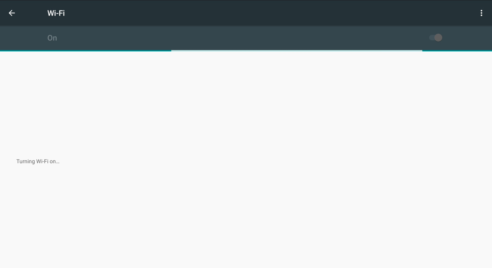
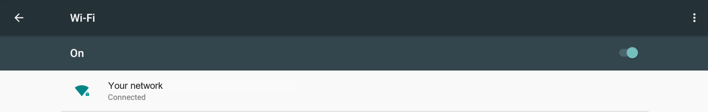

# Lululemon Studio mirror, part 1: install Android

This is the first of two guides for putting Glass Panes on a **Lululemon Studio mirror** ("Model One", formerly Mirror.co). It replaces the mirror's own software with Android 6.0.1, which can run the Glass Panes app.

1. **This guide:** install Android on the mirror.
2. **Next:** [install the Glass Panes app](install-app-lululemon-studio.md).

The whole job in one line: **put the mirror in fastboot, flash two files, change a few settings with scrcpy.** There are no scripts to run and nothing to build. Fastboot is a special mode of the mirror's bootloader in which it waits for your computer to send it files.

> **There is no way back.** This **permanently erases the lululemon software**. You can't take a backup first, because the bootloader refuses reads. Don't do this to a mirror you still want to use as a Lululemon mirror.

> **Tested on:** one unit. Board `MIR63A0-00-P1` (sticker reads `PCA#500240 RevP21`), stock software 1.25.0, flashed from Windows 11. Other boards and firmware versions are listed in [Which mirrors work](../compatibility.md#which-mirrors-work), and we'd love your report for yours.

> **Credit.** This path exists because of the Lululemon-mirror community, who worked out how to run Android on this hardware. Thank you to Onemoremichael, lrinQVQ, TimStewartJ, repairman29, porcuswine, vgab7 and everyone else in those threads.

## Step 0: make sure your mirror has the right board

**Do this before you buy, open or flash anything.** These images are built for the Qualcomm **MSM8916** board (`MIR63A0-00-P1`, tested on RevP21). Other owners report that some newer mirrors use a different NXP-based board (i.MX8M Mini). That needs different Android software with different partitions and drivers, **and these images will not work on it**. We have not tested one, and flashing the wrong image can leave a mirror that will not start.

- **Sticker on the main board** (near the micro-USB and Ethernet end): `MIR63A0-00-P1`, ideally `RevP21`. Anything else, stop here and [tell us what yours says](https://github.com/git-nimrod/glass-panes/issues/new/choose).
- **The FCC ID on the back sticker** (near where the power cable goes in): `2AOSD-RLSYM1R0` is the board these images are for. If the sticker says **"Contains: FCC ID `VPYLBEE5HY1MW`"** it is the newer NXP board, and these images will not work. Community projects exist for that board: see [Other boards and write-ups](../compatibility.md#other-boards-and-write-ups).
- **In fastboot** (step 1 below), `fastboot getvar product` must print `MSM8916`, and the partition sizes must match [the hardware page](hardware.md#what-the-bootloader-reports). `getvar all` prints nothing on this bootloader, so ask for each value one at a time. If they don't match, **don't flash**.
- **Optional, helps your report:** note which stock software version the mirror started on. On a mirror that is still set up for someone else's Wi-Fi, join the Wi-Fi hotspot it makes, then open that network's gateway address (the one ending in `.1`, which your computer shows for the connection) on port `8080` in a browser. That showed the version on one unit, and it may not work on yours.

Rough guide, not a promise: older units seem more likely to be the tested Qualcomm board, and later-production units are the ones to be careful with. The sticker is the real answer.

## What you need

| | |
|---|---|
| A mirror | Model One with the **MIR63A0-00-P1 RevP21** board. The sticker is on the main board near the micro-USB and Ethernet end. (The "FW AD V1.01" sticker is **not** the board id.) RevP18 units are reported to behave differently |
| Cable and computer | A **data** micro-USB cable (many cables only charge) and a Windows computer. Install Google's `platform-tools` (`adb` and `fastboot`) and [scrcpy](https://github.com/Genymobile/scrcpy) |
| The images | `system.img`, `userdata.sparse` and `SHA256SUMS` from the [`mirror-android-2` release](https://github.com/git-nimrod/glass-panes/releases/tag/mirror-android-2) |
| Time | About an hour. The first boot after flashing takes about 5 minutes |

## 1. Open the mirror and find the buttons

You only need this step for the first flash from lululemon's software. Nothing here changes the mirror yet.

1. Open the case. On some units a rear service hatch gives access to the board.
2. Find the two small buttons next to the "FW AD V1.01" sticker: **SW3 = VOL-** and **SW1 = VOL+**. The power button is a separate lone button near the camera connector.
3. Power comes from the wall through a power-supply board into the main board's 24 V connector. The micro-USB port is **data only**. It does not power the mirror.

| Hold at cold power-on | What happens |
|---|---|
| **VOL- (SW3)** | **Fastboot.** This is the one you want. The glass stays black in fastboot, and that is normal |
| VOL+ (SW1) | The lululemon update screen ("Update Complete!" with a checkmark, no menu), then it reboots by itself. A dead end |
| **Both** | Qualcomm EDL mode. **Avoid.** Generic programmers are rejected by the maker's secure boot |

A **cold boot** means cutting wall power. A trick that works: plug the mirror into a **switched power strip**, hold VOL- with a toothpick, switch the strip on, and keep holding for about 5 seconds.

**How to tell you are in fastboot.** The screen stays completely black, so you can't see it. Use the computer instead: hold VOL- while the power comes on and **keep holding for about 5 seconds**. You don't need to restart afterwards. On Windows, Device Manager then shows an unknown **"Android"** device (step 2). On a Mac (the tested path is Windows, so this is unverified), run `system_profiler SPUSBDataType` while you are still holding: an **"Android"** entry with vendor `0x18d1` and product `0xd00d` means fastboot, and `fastboot devices` should list it. If nothing shows up at all, the **cable** is the most likely cause (see step 2).

**Never connect anything to the UART pins** (header P1 and the pads near the audio header). They are **1.8 V logic, and the adapter's VCC must never be connected**. You don't need UART for this guide.

## 2. Get Windows to see fastboot

1. Connect the micro-USB cable and boot the mirror into fastboot (step 1).
2. In **Device Manager**, fastboot first appears as an unknown **"Android"** device with an error (`USB\VID_18D1&PID_D00D`).
3. Install the driver. In Android Studio, open **SDK Manager > SDK Tools**, tick **Google USB Driver** and install it. Then in **Device Manager**, right-click the device and choose **Update driver > Browse my computer > Let me pick > Have Disk**. Type the **full literal path** to `...\Android\Sdk\extras\google\usb_driver` (the variable `%LOCALAPPDATA%` does **not** expand there). Choose **Android Bootloader Interface**.
4. Reports differ about **Zadig with the WinUSB driver**: one owner of the same board said it works, another said it didn't and the Google driver did. Use the Google driver first.
5. Use a **normal (non-admin)** terminal and run `fastboot devices`. **Expected:** it lists the mirror.
6. **If nothing is listed at all**, and Device Manager shows no new device (on a Mac, `system_profiler` shows nothing), the usual cause is the **cable**. It has to be a micro-USB **data** cable, and many are charge-only. One owner went through four before one worked. Try a different cable and a different USB port before anything else.

## 3. Download and check the images

Download `system.img`, `userdata.sparse` and `SHA256SUMS` from the [`mirror-android-2` release](https://github.com/git-nimrod/glass-panes/releases/tag/mirror-android-2) into one folder. Before you flash anything, check that your copies are the real ones. In Windows PowerShell:

```powershell
Get-FileHash .\system.img -Algorithm SHA256
Get-FileHash .\userdata.sparse -Algorithm SHA256
```

Both fingerprints must match these exactly, and must also match the `SHA256SUMS` file:

```
bdb6b8445296666162256affa968d590075f56a8ad2229930f8502b9703e35c1  system.img
74b1f57ac20ce7c56065083a2bc3ddd283493be29d851fd04efc156ec96cf908  userdata.sparse
```

If either one is different, stop and download it again. Never flash a file that does not match.

## 4. Use the project ADB key on your computer

The mirror only lets **one ADB key** control it over USB. The ready-made images trust the Glass Panes project key, so your computer has to use that key. Do this before step 6.

`adb` finds its key in `%USERPROFILE%\.android\`. To use the project key, you put it there. That **replaces your own key for every Android device you have authorized**, so save yours first and put it back when you are done.

1. Download `adbkey` and `adbkey.pub` from [`mirror-app/android/project-key/`](../../mirror-app/android/project-key/) into a folder, for example `C:\gp-key`.
2. In PowerShell, **save your own key**, then copy the project key over it:

   ```powershell
   Copy-Item "$env:USERPROFILE\.android\adbkey" "$env:USERPROFILE\.android\adbkey.mine"
   Copy-Item "$env:USERPROFILE\.android\adbkey.pub" "$env:USERPROFILE\.android\adbkey.pub.mine"
   Copy-Item "C:\gp-key\adbkey" "$env:USERPROFILE\.android\adbkey" -Force
   Copy-Item "C:\gp-key\adbkey.pub" "$env:USERPROFILE\.android\adbkey.pub" -Force
   adb kill-server
   ```

   If you have never used `adb` before, there is no key of yours to save, and the first two lines will say the file is missing. That is fine.

**What this means:** the project key is public. Anyone who plugs a USB cable into a mirror running these images can control it. The images do not turn on `adb` over Wi-Fi, so it takes physical access. Treat the mirror like any other device in your home.

**To put your own key back later:** copy the two `.mine` files back over `adbkey` and `adbkey.pub`, then run `adb kill-server`.

## 5. Flash

**Point of no return.** Once these commands run, the lululemon software is gone. With the mirror in fastboot, run them from the folder that holds the files:

```bash
fastboot flash system system.img
fastboot -S 0 flash userdata userdata.sparse
fastboot reboot
```

- `system.img` is sparse, and fastboot splits it itself. **Expected:** 4 chunks, about **82 seconds**, all `OKAY`. Do **not** use `-S` on it.
- `userdata` **must be sent whole** (`-S 0`).
- The locked bootloader accepts writes to `system` and `userdata` only. That is normal.

## 6. First boot, then set up with scrcpy

1. The first boot shows the Android boot animation, then the Launcher3 home screen about **5 minutes** after the reboot. Be patient.
2. About 3 minutes into the boot, run `adb devices -l`. **Expected:** the mirror is listed as **`device`**. If it says `unauthorized`, wait a few minutes more. If it still does, your computer isn't using the project key (step 4). Make sure you ran `adb kill-server` after copying it. If `adb devices` shows **nothing**, give it a full 5 minutes after the reboot (the first boot is slow) before you start debugging; then check the cable and the USB port.
3. Start **scrcpy**: `winget install Genymobile.scrcpy`, then run `scrcpy`. The mirror's own touch screen is not usable, so scrcpy is how you click things. The first time, the mirror may ask **"Allow USB debugging?"**. Tick **Always allow from this computer** and click **OK** with the mouse in the scrcpy window.
4. In Settings (inside scrcpy), turn **Wi-Fi on** and join your network. "Turning Wi-Fi on..." can take about a minute.

   

   When it has joined, your network shows "Connected":

   
5. Keep the screen awake while you work. The last command dismisses the lock screen:
   ```bash
   adb shell settings put global stay_on_while_plugged_in 7
   adb shell settings put system screen_off_timeout 2147483647
   adb shell input keyevent 82
   ```
6. **Turn the picture upright.** The mirror's screen is landscape-native and a fresh Android starts in landscape, so everything is sideways until you set the rotation. If your picture comes out upside down, use `1` instead of `3`:
   ```bash
   adb shell settings put system accelerometer_rotation 0
   adb shell settings put system user_rotation 3
   ```
7. Note the mirror's address (Settings > About, or your router's device list). You'll need it in part 2.

### What to expect

- **Wi-Fi takes about 2.5 minutes after a cold power-on.** The first attempt fails once, then Android restarts it and it connects by itself.
- **A soft reboot can leave stripes in the text.** A full power cut fixes it. The Glass Panes app also turns off the display feature that causes it.
- **The timezone is stuck on UTC.** Glass Panes shows your Home Assistant's timezone, so you don't need to change it.
- **`adb` over Wi-Fi never authorizes** on this unit. Use the cable.
- **Sleep is fully dark** with the `mirror-android-2` images: when Android puts the screen to sleep, the panel switches off completely, with no backlight glow (the older `mirror-android-1` images left a faint glow). Wake it with `adb shell input keyevent 224` and sleep it with `223`. A smart plug is still the way to cut power entirely.
- There is **no root** (`adb` runs as the `shell` user).

## Updating from `mirror-android-1`

Already running the first images? You only need the new `system.img`. Your `userdata` stays, so the Glass Panes app and its settings, your Wi-Fi and the ADB key are kept.

1. Download `system.img` and `SHA256SUMS` from the [`mirror-android-2` release](https://github.com/git-nimrod/glass-panes/releases/tag/mirror-android-2) and check the fingerprint (step 3).
2. With the mirror running and plugged in by USB, put it in fastboot without opening it: `adb reboot bootloader`. After about 10 seconds, `fastboot devices` should list it. (This worked on the tested unit. If nothing is listed and the mirror boots normally, use VOL- at a cold power-on as in step 1.)
3. Flash only system, then restart:
   ```bash
   fastboot flash system system.img
   fastboot reboot
   ```
   Do **not** flash `userdata`: that would erase the app and its settings.
4. Give it about 5 minutes. After a cold power-on, Wi-Fi again takes about 2.5 minutes.

## If something goes wrong

- **Stuck before Android boots:** put the mirror back in fastboot (VOL- at cold power-on) and flash again. You can rewrite `system` and `userdata` as often as you like.
- **Fastboot isn't found:** repeat step 2 (the driver), and try another **cable** and USB port.
- **Nothing shows up in `adb devices` after flashing:** wait 5 minutes, then check the cable and USB port, and that you copied the project key (step 4).
- **`unauthorized` after flashing:** repeat step 4, then run `adb kill-server` and `adb devices -l`.
- **No Wi-Fi:** open an issue and say which board revision and software version you have (see below).

Please report results for other board revisions or firmware in a Glass Panes issue, so this page can say what worked where. Don't post your mirror's serial number.

## Next

[Part 2: install the Glass Panes app](install-app-lululemon-studio.md).
